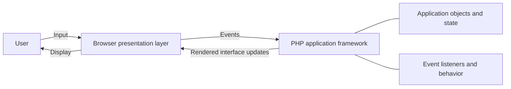

# HIEQueryUI

**A server-side PHP application framework inspired by PHP-GTK**, from Harbour Island Ecologics Inc.

Build applications from persistent PHP objects, UI components, and event listeners. Application state, behavior, and decisions stay on the server. The browser acts as a thin presentation layer: it forwards user input and displays server-rendered updates, with as little client-side intelligence as possible.

The PHP-GTK inspiration is the programming model: construct an interface, connect events to listeners, and respond by changing objects in PHP. Widgets and listeners can be combined into larger applications while keeping each component's code understandable.



JavaScript handles transport and presentation mechanics such as request ordering, typing debounce, and focus retention. Application rules run in PHP.

## Run the demo

Requires PHP 8.2 or newer with sessions and a modern browser. No database, Composer installation, or JavaScript build step is needed.

```sh
php -S 127.0.0.1:8080
```

Open `http://127.0.0.1:8080/examples/index.php`. The example includes a counter, text input, and checkbox. Full-page and embedded examples are also in examples/.

The [Label example](examples/label.php) shows input and checkbox captions, trusted markup, and text updated by a PHP listener.

The [Button example](examples/button.php) shows icons, accessible names, and enabling or disabling actions from PHP.

The [Input example](examples/input.php) validates a quantity in PHP and shows read-only and disabled states.

The built-in PHP server is for local development. Deploy behind your normal PHP web server for public use.

## Build an application in PHP

```php
$button = new \HIEQueryUI\Button('Add item');
$button->addClickListener($controller); // implements HIEQueryUI\onClick
```

The controller receives that widget in `onClick(Widget $widget)`. Changing a protected widget property through its public magic setter queues a refresh. Container additions/removals and Viewport.set() also queue updates.

Load class definitions **before** session_start(), create the UI once, and keep it in the session. [The complete example](examples/index.php) shows the lifecycle; [Counter.php](examples/Counter.php) shows listeners.

## Install in another application

Require `HIEQueryUI.php`, or use Composer's files autoload through this repository. Use a Composer VCS or path repository for `hie/hiequeryui`.

Serve assets/hiequeryui.js and set runtimeUrl to its browser URL. Event requests default to the current request URL; url can override this with a same-origin path. The default widgets need no third-party browser library. Set filebase only when using the optional AdminLTE 3 shell with your own browser assets.

## Documentation

- [Architecture](docs/architecture.md), [callbacks](docs/callbacks.md), [widget API](docs/widgets.md)
- [Session lifecycle](docs/lifecycle.md), [persistence](docs/persistence.md)
- [Events](docs/events.md), [rendering](docs/rendering.md), [browser support](docs/browser.md)
- [Theming and assets](docs/theming.md), [migration](docs/migration.md)
- [Tests](docs/testing.md), [release checklist](docs/release-checklist.md)
- [Component roadmap](ROADMAP.md), [writing a widget](docs/widget-development.md), [changelog](CHANGELOG.md)

## Status

Release candidate. Automated tests cover callbacks, session restoration, escaping, request validation, update queues, encoding, and all rendering modes. Local testing uses PHP 8.4; CI is configured for PHP 8.2, 8.3, and 8.4.

MIT licensed. Copyright Harbour Island Ecologics Inc. Cyberdom Online's historical packages used the Cy prefix; the current Harbour Island packages use HIE.
