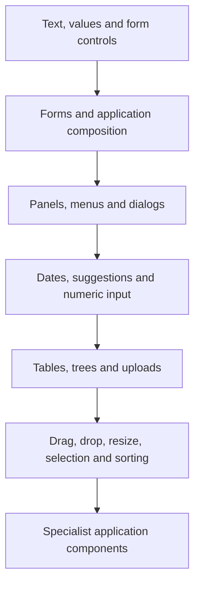

# Application component roadmap

The next package updates will build the component set expected of a general application framework. HIEQueryUI remains inspired by PHP-GTK: PHP owns application objects, state, rules, and listeners; browser code provides input and presentation mechanics.

Entries marked **planned** describe upcoming work. See the [widget API](docs/widgets.md) for available components.

## Reference and scope

The reference is the [jQuery UI demo catalogue](https://jqueryui.com/demos/), specifically its [widgets](https://api.jqueryui.com/category/widgets/) and [interactions](https://api.jqueryui.com/category/interactions/). It informs the capabilities to cover, not the implementation architecture or a new dependency. Forms, data views, uploads, and application layout below extend that reference for HIEQueryUI's application-framework scope.

Widgets are being added individually, with examples, tests, and documentation. The [widget guide](docs/widget-development.md) describes the common conventions.

The order follows dependencies: Select comes before SelectMenu, and DatePicker and TimePicker come before DateTimePicker. API details may change as each component is developed.

## 1. Values and form controls

| Order | Component | Status | Initial scope |
|---|---|---|---|
| 1 | Label | Planned | Escaped text, explicit trusted HTML, associated input label |
| 2 | Button | Existing; upgrade planned | Disabled state, icon/text slots, accessible action semantics |
| 3 | Input | Existing; upgrade planned | Declared input options, read-only/disabled state, server-side value validation hooks |
| 4 | TextArea | Planned | Multiline text, bounds, read-only/disabled state |
| 5 | Checkbox | Existing; upgrade planned | Clear checked/unchecked contract, disabled state, associated label |
| 6 | RadioButton | Planned | Group identity, allowed option values, one accepted selection |
| 7 | Select | Planned | Native single/multiple choice, stable option keys, server-validated selection |
| 8 | ProgressBar | Planned | Determinate/indeterminate progress and accessible status |
| 9 | Alert | Planned | Severity, accessible messages, optional dismissal callback |

Existing Input types should be used for straightforward password/email/numeric inputs where appropriate; a new class needs a distinct contract, not just a different HTML type.

## 2. Application composition

| Order | Component | Status | Initial scope |
|---|---|---|---|
| 10 | FieldSet | Planned | Related controls, legend, child ownership |
| 11 | ControlGroup | Planned | Group existing controls with consistent layout and focus order |
| 12 | Form | Planned | One explicit submit snapshot, PHP validation and field errors |
| 13 | Card | Planned | Header/body/footer composition using existing children |
| 14 | Box | Planned | Information and counter layouts with declared content slots |
| 15 | Toolbar | Planned | Groups of existing actions and keyboard navigation |
| 16 | StatusBar | Planned | Application status regions and accessible announcements |

## 3. Panels and navigation

| Order | Component | Status | Initial scope |
|---|---|---|---|
| 17 | Tabs | Planned | Named panels, PHP-owned active panel, selection callback |
| 18 | Accordion | Planned | Expandable sections with accepted open/closed state |
| 19 | Menu | Planned | Enabled actions, submenus and keyboard operation; distinct from page Navbar |
| 20 | Dialog | Planned | Open/close state, content, actions, modal focus behavior |

Container, Viewport, Navbar, NavItem and LTEAdminUI already exist. Improvements to them should each be scoped to the affected component, not bundled into a new widget commit.

## 4. Rich input

| Order | Component | Status | Initial scope |
|---|---|---|---|
| 21 | DatePicker | Planned | Canonical date, PHP date bounds and permitted-day checks |
| 22 | TimePicker | Planned | Canonical time, step/range and explicit timezone interpretation |
| 23 | DateTimePicker | Planned | Compose existing date/time controls with a timezone contract |
| 24 | Spinner | Planned | Numeric value, min/max/step, keyboard and increment controls |
| 25 | Slider | Planned | Bounded value or range; PHP accepts committed values |
| 26 | Autocomplete | Planned | PHP suggestion provider, stable result IDs and explicit selection |
| 27 | SelectMenu | Planned | Enhanced Select presentation preserving its PHP option contract |
| 28 | Tooltip | Planned | Text/help content, keyboard/focus access and positioning |

## 5. Data and application content

| Order | Component | Status | Initial scope |
|---|---|---|---|
| 29 | Image | Planned | Source, alt text, dimensions and loading/error presentation |
| 30 | LinkButton | Planned | Navigation action, safe URL policy, accessible label |
| 31 | Pagination | Planned | PHP-owned page/total and page-change callback |
| 32 | Table | Planned | Columns, row keys, server-side sorting/paging and selection |
| 33 | TreeView | Planned | Stable node IDs, PHP-loaded children, selection and expansion |
| 34 | FileUpload | Planned | Explicit upload endpoint, PHP size/type/authorization checks and progress |

FileUpload will use a dedicated upload endpoint rather than the Base64 field used for widget events.

## 6. Reusable interaction behaviors

These behaviors attach to widgets and share their existing event and rendering lifecycle.

| Order | Behavior | Status | PHP authority / browser mechanics |
|---|---|---|---|
| 35 | Draggable | Planned | PHP accepts final position; browser tracks the pointer |
| 36 | Droppable | Planned | PHP accepts source/target relation; browser displays candidate targets |
| 37 | Resizable | Planned | PHP accepts bounded dimensions; browser draws the resize feedback |
| 38 | Selectable | Planned | PHP validates selected IDs; browser provides pointer/keyboard selection feedback |
| 39 | Sortable | Planned | PHP validates item membership/order; browser previews rearrangement |

Avoid a server round trip per animation frame. Temporary visual feedback is presentation; the committed position, size, membership or order remains subject to PHP validation. Server rejection restores the accepted state. Keyboard alternatives belong in the same behavior's scope.

## 7. Specialist components

| Component | Status | Next step |
|---|---|---|
| Chat | Planned after core controls | Define messages, authors, paging and application-controlled delivery |
| Social | Contract undecided | Define the actual application use case before creating an implementation |

Effects and positioning utilities are optional presentation work. They do not take priority over completing usable application components. A JavaScript widget factory is not part of this plan.

## Completion

Completed widgets include an implementation, a standalone example, API documentation, automated tests, and browser checks for interaction and accessibility.
