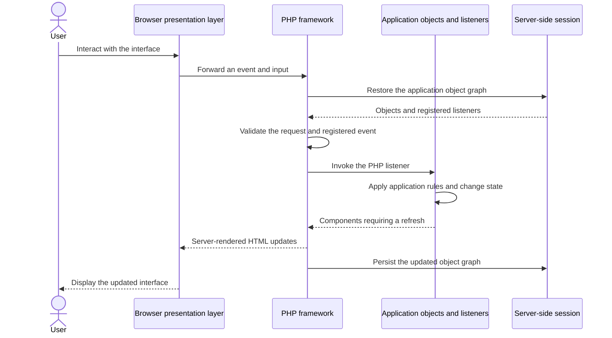

# Architecture

HIEQueryUI is a server-side application framework inspired by PHP-GTK. Its central design decision is to keep application intelligence in PHP and use the browser as a thin presentation layer. Applications are composed from objects, UI components, and listeners whose state survives requests through the session.

The current core has four pieces: PHP widgets, listener interfaces, a session-persisted application wrapper, and a browser transport. A widget owns its HTML; a listener responds to events and coordinates application behavior. The wrapper validates browser requests and sends rendered changes back.

The host loads classes and starts the session before calling the wrapper; session restoration in the diagram is part of that PHP request lifecycle. The static widget registry resolves restored IDs. The changed registry is a map, so a component has one outstanding update. The browser replaces elements by their IDs.

## Where behavior belongs

- **PHP application objects:** authoritative application and UI state, business rules, validation, authorization, and coordination with application services.
- **PHP components and listeners:** interface composition, event responses, rendering, and change tracking.
- **Browser runtime:** forward input, encode requests, preserve request order, apply markup, and retain focus. Browser-side behavior should serve presentation rather than decide application outcomes.

The session restores PHP objects on each request; this is not a continuously running PHP process. Database connections and other external resources are obtained during a request rather than serialized into the interface graph.

## Current implementation and growth

The host currently supplies session configuration, access control, application services, and static asset serving. AdminLTE is an optional shell. There is currently no built-in database layer or application router.

New widgets use the same PHP objects, listeners, and rendering queue as the existing components. The [roadmap](../ROADMAP.md) lists planned additions.
