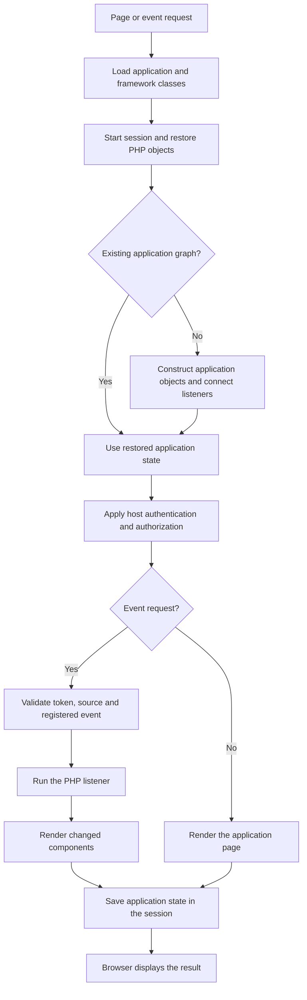

# The request lifecycle

The browser forwards an interaction; PHP restores the application, runs its listener, and renders the result. Application objects remain authoritative throughout.

1. Load HIEQueryUI.php and every application widget/listener class.
2. Call session_start(). PHP restores the UI graph; each widget's __wakeup() registers its ID.
3. On the first request, create the root and HIEQueryUI wrapper and place the wrapper in the session. Constructors register new widgets too.
4. Call start() once. A page request renders the root; an event request validates and invokes a registered listener before rendering changes.
5. Let PHP save the session normally.

Keep one UI wrapper per event endpoint. Do not recreate the graph on every request: browser IDs and request tokens belong to the persisted graph. If an application resets its session, already-open pages need to reload. Unknown controls and stale tokens receive controlled errors.

Application authentication and authorization must happen before start(). The library does not manage users or grant permissions.
